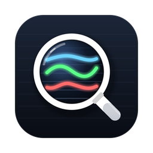
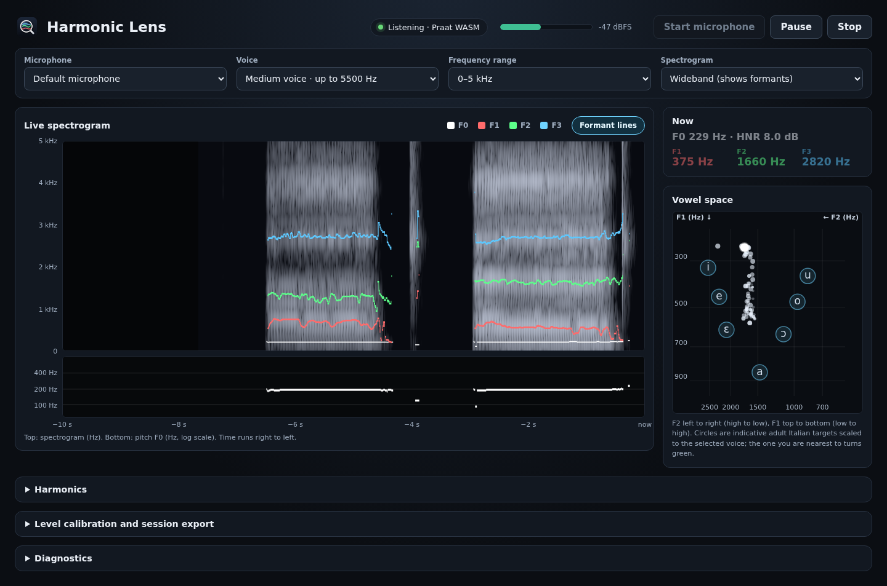

<p align="center"></p>

# Harmonic Lens

GPL-2.0-or-later **real-time** vocal analyzer: the Praat-style view of your voice (spectrogram, F0, formants
F1-F4, HNR, harmonics) while you sing or speak, instead of record-then-inspect. Built for vowel and voice
training: you see where your vowels land on an F1 x F2 chart as you say them.



## Status: first beta (0.1.0-beta.1)

The formant estimator is scored against 1668 hand-checked human vowels (Hillenbrand et al. 1995) and compared
with Praat on running Italian and English speech and on sung vowels. The desktop packages build in CI and the
Linux one is smoke-tested with a fake microphone. **The macOS and Windows builds have not yet been run on real hardware**, and no real
microphone has been used in CI: that is what this beta is for. Please report what breaks.

## Download

Get the file for your system from the [latest release](../../releases/latest). The apps are not signed or
notarized, so each system asks for one approval on first launch:

| System | File | First launch |
|---|---|---|
| macOS 13+ (Apple Silicon and Intel) | `harmonic-lens-<version>-mac-universal.zip` | Unzip, move to Applications, then right-click the app and choose **Open**. Or run `xattr -dr com.apple.quarantine "/Applications/Harmonic Lens.app"`. Allow the microphone when asked. |
| Windows 10/11 | `harmonic-lens-<version>-win-x64.exe` (portable) | Run it. If SmartScreen warns, choose **More info**, then **Run anyway**. |
| Linux x86_64 | `harmonic-lens-<version>-linux-x86_64.AppImage` | `chmod +x` the file and run it. On Ubuntu 24.04+ you may need `--no-sandbox` (AppArmor user-namespace restriction). |

If the microphone stays silent on macOS, check **System Settings, Privacy & Security, Microphone** and the
**Diagnostics** panel in the app.

## Using it

1. Press **Start microphone** and sing or say a sustained vowel.
2. Pick **Voice** (low, medium, high/child). It sets the highest formant searched and the pitch range, and it
   matters: a wrong choice makes formants jump. For an adult male voice use *Low*.
3. Watch the **spectrogram** (F0 white, F1 red, F2 green, F3 blue) and the **vowel space**: your last second
   leaves a trail, and the nearest indicative Italian vowel target turns green.
   The **Harmonic guides** panel draws lines at n × F0 on the spectrogram (H1-H8) next to a table of the measured peaks;
   they are separate from the formant lines, which have their own switch above the spectrogram.
4. **Calibration and export** (collapsed panel): enter the reading of a sound level meter while a steady sound
   plays to show dB SPL for that microphone, and export the session (time, level, F0, HNR, F1-F4) as CSV.
5. Settings and the calibration are remembered between runs.

## What it does

- Microphone via `getUserMedia` and an `AudioWorklet` (all channels averaged to mono, input never played back).
  The worklet sends audio straight to an analysis Worker; the main thread only paints. The microphone can be
  switched while listening.
- One analysis pipeline (`src/dsp/engine.ts`), ~10 ms hop, ~2 ms CPU per frame:
  - F0 and HNR from the pinned Praat v7.0.02 WASM (raw autocorrelation pitch, cross-correlation HNR). HNR runs
    on an 8 kHz decimated copy every 4th hop (the Praat call costs 35-100 ms at 48 kHz); deliberate divergence,
    about 0.5 dB on voiced signals.
  - Formants: TypeScript port of Praat's Burg algorithm (`src/dsp/formants/`), validated against Praat 6.1.38
    via parselmouth (median F1-F3 error under 0.15% on clean synthetic vowels).
  - Formants F1-F4 are tracked over time (`src/dsp/formants/tracker.ts`): poles are assigned to slots by dynamic
    programming with temporal continuity, a 3-frame median, and no history across unvoiced frames. Formants are
    reported only while a pitch track exists, after 3 voiced frames.
  - Praat-style Gaussian spectrogram (wideband 5 ms for formants, narrowband 30 ms for harmonics), pre-emphasis
    from 50 Hz, selectable 0-3/5/8 kHz range.
  - Eight n x F0 harmonic guides with measured peaks; a pitch tracker bridges dropouts and rejects isolated
    octave jumps.
- UI: single-screen layout, labelled Hz and time axes, F0 and F1-F3 lines over the spectrogram, F1 x F2 vowel
  space, input level meter, pause/resume, collapsible harmonics, calibration/export and diagnostics panels.
- If the Praat WASM fails to load the UI says so (pitch/HNR off); there is no hidden fallback estimator.
- Electron has `contextIsolation`, sandbox, no Node integration and an audio-only permission for the trusted main
  page. Only a few preferences are stored (voice type, range, calibration); audio is never written to disk.

**Not implemented yet:** audio recording and playback (the CSV export has measurements only), personal vowel
targets (the chart uses indicative adult Italian values scaled by voice type), signed and notarized builds.

## End-to-end check

`tools/e2e/` drives the built app in headless Chromium with a fake microphone playing synthetic
vowels (a, i, u) and fails on regressions (F0 coverage, formants present, latency, frame rate):

```sh
python3 tools/e2e/synth_vowels.py /tmp/vowels
python3 tools/e2e/run_app.py /tmp/vowels.wav /tmp/run 9   # needs playwright + chromium; builds dist/ first
```

`tools/e2e/make_real_vowels.py` builds the same kind of fake-mic WAV from human recordings
(Hillenbrand et al. 1995, 1668 tokens with hand-checked formants; not vendored, fetch it separately).

## Formant benchmark

`tools/bench/hillenbrand-bench.ts` (steady-state point) and `tools/bench/hillenbrand-track-bench.ts`
(every frame of the vowel nucleus, cold start from the token onset) score F1-F3 against Hillenbrand's
measurements. Fraction of frames with >20 % error (`--raw` = unfiltered poles, no tracker):

| condition | raw poles | tracked |
|---|---|---|
| clean, voice type matched | 2.35 % | 1.46 % |
| voice type set wrong (`--max 5500` for all) | 3.82 % | 1.03 % |
| white noise, SNR 30 dB (`--snr 30`) | 2.56 % | 2.13 % |
| white noise, SNR 20 dB | 6.47 % | 6.53 % |

Real-microphone behaviour is host-dependent. `tools/bench/own-voice.ts` and `tools/bench/speech-vs-praat.ts` compare the
engine with Praat on your own recordings and on running speech.

## Deterministic verification

Requirements: Node.js 22.12+; Linux AppImage needs normal Electron Builder host
tools. Clean clone contains pinned browser artifacts in `public/praat-wasm/`.

```sh
npm ci --include=dev
npm test
npm run praat:fixtures:check
npm run praat:wasm:stage:check
npm run build
npm run package:linux   # also package:mac:universal, package:win
```

`npm run build` runs staged-WASM hash check first. `npm run
praat:wasm:stage` copies locally rebuilt artifacts from
`analysis-output/praat-wasm-wrapper/`, then checks hashes against
[`public/praat-wasm/manifest.json`](public/praat-wasm/manifest.json). Rebuilds
need pinned Praat `v7.0.02` / `6f3da9ef1d8cce0d5684afc104d02888dfc71b25` and
Emscripten `3.1.69`; changed output requires deliberate manifest review/update.

For local live use:

```sh
npm run dev
npm run dev:desktop
```

Use localhost or HTTPS. `npm run package:linux` produces
`release/Harmonic Lens-<version>.AppImage`; artifacts are unsigned.

## macOS (Apple Silicon and Intel)

CI builds one **universal** ZIP (`harmonic-lens-<version>-mac-universal.zip`, arm64 + x64) on GitHub's
`macos-15` runner, so there is no architecture to choose. `package:mac` (arm64) and `package:mac:x64` stay
available. The project has no native Node modules, so the JS/WASM payload needs no per-architecture build.

**Signing.** `build.mac.identity` is `"-"` (ad-hoc) with `hardenedRuntime: false`. Both halves matter:

- `identity: null` makes electron-builder skip signing entirely. The unpacked bundle then has no
  `_CodeSignature`, and Apple Silicon refuses to launch an edited, unsealed Electron bundle (the "app is
  damaged"/will not open symptom).
- electron-builder [#9529](https://github.com/electron-userland/electron-builder/issues/9529) reported silent
  microphone tracks for ad-hoc builds. The cause is hardened runtime becoming effective once a signature
  exists, which then needs the `audio-input` entitlement. Ad-hoc with `hardenedRuntime: false` works,
  microphone included, so no entitlement file is needed.

Artifacts are not notarized, so the first launch of a downloaded copy needs one approval:
right-click the app, choose **Open**, or run `xattr -dr com.apple.quarantine "/Applications/Harmonic Lens.app"`.
Developer ID signing and notarization would remove this. The packaged app requires macOS 13 or newer (Electron 44).

Packaged `Info.plist` includes `NSMicrophoneUsageDescription`. Electron's main process allows audio-only
media requests from the exact top-level app page and, on macOS, asks TCC for microphone access. A denial is
not re-prompted: enable Harmonic Lens in **System Settings → Privacy & Security → Microphone**, quit, then
reopen it. For local reset testing:

```sh
tccutil reset Microphone org.harmoniclens.app
```

The macOS runtime itself is not exercised in CI: run the checklist in
[macOS verification](docs/macos-arm64.md) on a physical Mac.

## Desktop smoke test

`tools/e2e/run_electron.py` launches the real Electron app (production permission handlers with
`HL_REAL_PERMISSIONS=1`) under Xvfb with a fake microphone and fails unless F0 and formants appear without
page errors. CI runs it on the Linux build. `tools/e2e/check_lifecycle.py` stresses start/stop/restart and
live microphone switching. On Ubuntu 24.04+ an AppImage may need `--no-sandbox` because of the AppArmor
user-namespace restriction.

## Verification boundary

Native oracle, fixture hashes, WASM parity, runtime integration, packaging, and
manual-test boundaries: [verification status](docs/verification-status.md).
Praat provenance/ABI: [WASM probe](docs/praat-wasm-probe.md) and
[golden contract](docs/praat-golden.md). Product milestones: [ROADMAP.md](ROADMAP.md).
